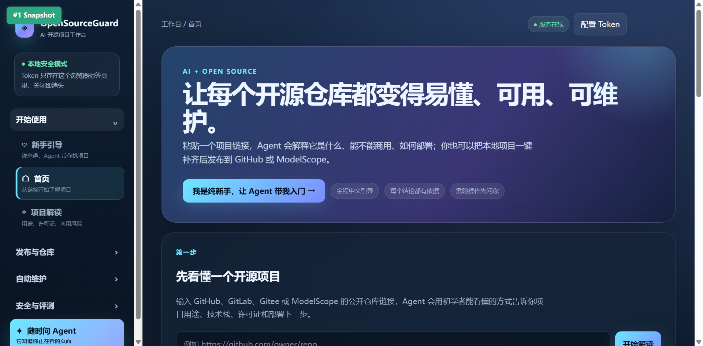
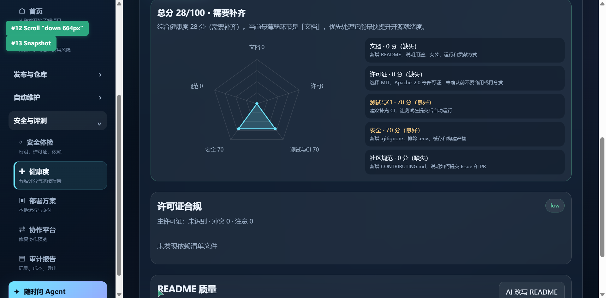
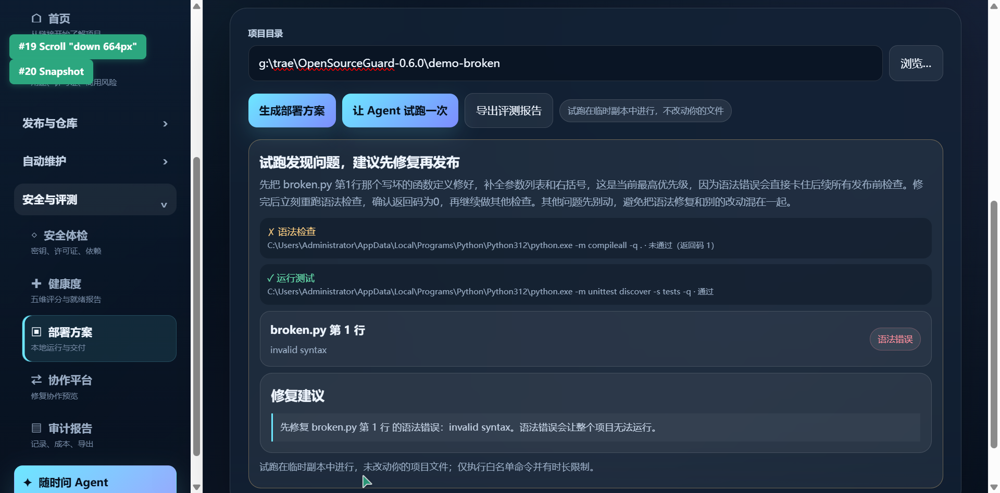

# OpenSourceGuard · AI 开源项目工作台

> **让每个开源仓库都变得「易懂、可用、可维护」**
> 面向零基础开发者的一站式 AI 开源工作台：看懂 → 建好 → 发布 → 维护
> 申报方向：**AIC·AI+开源竞赛 —— AI 开发工具与开源协作**

---

## 作品简介

高校学生参与开源普遍面临四道门槛：**看不懂**陌生仓库、**建不齐**规范文件、**发布前**发现不了低级错误、**项目长期无人维护**。

OpenSourceGuard 将「看懂—建好—发布—维护」整合为一条完整链路：

| 环节 | 解决什么 | 关键能力 |
|---|---|---|
| 🧭 看懂 | 新手不知道仓库是什么、能否商用 | 远程仓库解读（GitHub / 魔搭 / Gitee）、双平台热门榜、零基础新手引导 |
| 🛠️ 建好 | 项目缺 README/LICENSE 等规范文件 | 一键补齐 6 类文件（只新增、不覆盖）、健康度五维评分 + AI 改写 README |
| 🚀 发布 | 发布后才暴露低级错误 | 发布前试跑（语法检查 + 单测）、安全体检、供应链漏洞扫描 + SBOM、确认式发布 |
| 🔁 维护 | Issue 积压、项目沉寂 | 自动维护队列：Agent 产补丁草稿 → 一律人工审核；安全风险自动转人工 |

**核心原则：AI 只建议，人做决定。** 所有危险操作均「先预览、后确认」，高风险代码变更永远有人把关。

---

## 界面速览

工作台为单文件原生前端，侧边栏多页面布局，服务默认仅监听本地回环地址。

| 工作台首页 | 健康度五维雷达图 | 发布前试跑拦截语法错误 |
|---|---|---|
|  |  |  |

---

## 核心功能

### 1. 远程仓库解读与热门榜单
粘贴 GitHub、魔搭、Gitee 公开仓库链接，即得项目画像：用途、技术栈、Star/Fork、许可证及**商用判断**、上手命令、风险提醒与下一步建议；Agent 输出多段落深度解读。全程**只读公开信息，不下载、不执行**仓库代码。「为你推荐」每 6 小时抓取双平台热门项目，失败时用缓存并明确标注，保证数据可信。

### 2. 零基础新手引导
说一句话（如"我想做游戏"），Agent 从真实热门项目中按兴趣匹配并给出中文推荐理由，生成「读—跑—改—发—维护」五步学习路线。推荐由真实榜单数据 + 兴趣匹配 + AI 润色共同完成，并非写死话术。

### 3. 随时问 Agent
支持 OpenAI 兼容模型端点（默认适配 DeepSeek）。**思考过程与回答分离展示、逐字流式输出**；Agent 感知当前页面与最近操作，自动切换本地/远程上下文。无网络或未配置密钥时自动降级为本地规则引擎，功能不中断。

### 4. 一键补齐规范文件
按开源规范检查 6 类文件（README、LICENSE、.gitignore、SECURITY、.env.example、CONTRIBUTING），**先预览、后确认**，只新增、不覆盖；目录变更后旧预览自动失效，防止误执行。

### 5. 发布前试跑
在临时目录执行白名单命令（compileall 语法检查 + unittest），带超时保护，**不改动原项目**。失败时定位到具体文件与行号并给出修复建议（见上图）。

### 6. 安全体检与供应链安全
体检扫描密钥泄漏、许可证缺失等风险；供应链模块对接 **OSV.dev** 批量查询已知漏洞、按 **OpenSSF OSPS Baseline** 控制域打分，可导出符合 **CycloneDX 1.5** 标准的 SBOM。

### 7. 健康度五维评分 + AI 改写
从文档、许可证、测试与 CI、安全、社区规范五维量化健康度，输出总分、雷达图与逐项建议；同时完成依赖许可证合规检查与 README 质量评估；AI 改写可生成完整改进版；支持导出 HTML 就绪度报告。

### 8. 自动维护：从 Issue 到人工审核
录入 Issue → SQLite（WAL）队列 → Agent 生成补丁草稿与验证说明 → **一律不自动合并**，提交人工审核；`security`/`critical` 标签任务执行时自动转人工（blocked）。失败日志可回流「继续修复」形成迭代闭环。

### 9. 项目整理与审计报告
自动识别临时/重复文件与疑似敏感文件，确认后仅归档安全文件至 `.osg_archive`，`.env` 等敏感文件**绝不自动移动**。审计报告完整记录 AI 执行过的任务、结论与高风险策略，可导出 Markdown/HTML——**AI 做过什么，全程可查、可追责**。

### 10. 可选 AI 增强：本地决策模型 + 长期上下文记忆
- **Laya 决策路由**（`/api/laya/route`）：本地 System-1 决策模型（Apache-2.0 权重，CPU 推理），对模糊意图做快速 typed-decision。确定性关键词规则**优先**，Laya 低置信度（<0.85）时自动转人工回退；模型缺失时纯规则兜底，主路径零依赖不受影响。
- **OpenViking 上下文数据库**（`/api/openviking/*`）：为 Agent 提供跨会话长期记忆——把对话与项目解读写入 OpenViking 会话/资源，后续提问可检索复用，提升上下文连续性。客户端为纯标准库实现，API Key 仅存本地 `.env`、不随作品分发；未配置时接口自动降级返回说明。

两项增强均已实测（见 `scripts/verify_ai_enhancements.py`），不影响项目"零第三方运行依赖"的核心承诺。

---

## 技术架构

- **后端**：纯 Python 标准库（`dependencies = []`，零第三方运行依赖，Python ≥ 3.10），`ThreadingHTTPServer` 本地服务，默认仅监听 `127.0.0.1:8099`
- **前端**：单文件原生 JavaScript 工作台，无构建步骤、无第三方框架
- **存储**：SQLite（WAL 模式），任务队列与审计记录持久化
- **外部能力**（全部可配置、缺失自动降级）：OpenAI 兼容模型端点、GitHub / 魔搭 / Gitee 开放接口、OSV.dev 漏洞库
- **领域模块**：20 余个高内聚模块，规则引擎与 AI 调用解耦，可独立测试

---

## 实现完成度与可验证效果

- ✅ **74 项自动化测试全部通过**（`python -m unittest discover -s tests`），零第三方依赖保证结果可复现
- ✅ **四个可复现演示数据集**（正反例齐全，评审可零配置复现）：

| 演示目录 | 场景 | 实测结果 |
|---|---|---|
| `demo-ok` | 最小合法项目 | 试跑 passed；健康度 28/100（五维真实数据）；补齐识别 6 个缺项 |
| `demo-broken` | 含语法错误的反例 | 试跑 failed，定位第 1 行 invalid syntax 并给修复建议 |
| `demo-vuln` | 旧版本依赖 | 3 个依赖 44 个已知漏洞（高危 8）；OSPS 评分 20；可导出 SBOM |
| `demo-messy` | 13 个文件杂乱目录 | 识别 3 个临时/重复、1 个疑似敏感（.env）、4 个可归档；敏感文件不被移动 |

- ✅ 全部功能经浏览器逐页实测验收，形成「新手线 / 作者线 / 维护者线」三条完整演示路径

---

## 快速开始

```bash
# 只依赖 Python 3.10+ 标准库，无需安装第三方包
cd opensourceguard
python -B -m opensourceguard.server --host 127.0.0.1 --port 8099
```

浏览器打开 <http://127.0.0.1:8099/> 即可体验全部功能。运行测试：

```bash
python -m unittest discover -s tests   # 74 项全部通过
```

> 可选增强：配置 `.env` 中的 OpenAI 兼容模型端点（如 DeepSeek）后，Agent 由「本地规则摘要」升级为「AI 深度解读与问答」；未配置时所有功能仍可用。

---

## 安全与合规设计

- **凭据安全**：平台 Token 仅存浏览器 `sessionStorage`，关闭标签页即清除；不写盘、不入日志、不进入 Git remote
- **危险操作两段式**：发布、补齐、整理均为「先预览、后确认」
- **敏感文件保护**：`.env` 等疑似敏感文件绝不自动移动或上传
- **高风险转人工**：`security`/`critical` 标签任务自动 blocked，AI 不触碰安全代码
- **远程只读**：仓库解读不下载、不执行目标代码；默认模式不修改远程仓库、不写主分支、不自动合并
- **网络收敛**：服务默认仅监听本地回环地址
- **许可证**：本项目以 **MIT License** 发布（见 [LICENSE](LICENSE)）

---

## 开放成果与后续计划

**开放成果**
- 完整源代码仓库（23 个业务模块 + 单文件前端），MIT License，权利边界清晰
- 74 项自动化测试套件，一条命令可复跑验证
- 四个演示数据集（`demo-ok` / `demo-broken` / `demo-vuln` / `demo-messy`），可复现测试基线
- 技术文档与审计报告导出样例

**后续计划**
- 模型端点配置化增强、更多代码托管平台适配
- 健康度指标体系扩展
- 社区共建机制与真实仓库维护试点

---

## 竞赛材料索引

- `docs/AIC_TECHNICAL_REPORT.md` — 技术报告草稿
- `docs/AIC_VIDEO_SCRIPT.md` — 演示视频脚本（3—5 分钟）
- `docs/AIC_PPT_OUTLINE.md` — 答辩 PPT 大纲
- `docs/AIC_RESOURCE_MANIFEST.csv` — 开源及第三方资源使用清单
- `docs/FEATURE_MATRIX.md` — 功能基线
- `docs/CASE_STUDY_EMPTY_CSV.md` — 可核验案例

所有示例均使用自主构造的合成数据，仓库不含任何凭据、个人信息或第三方受限代码。
